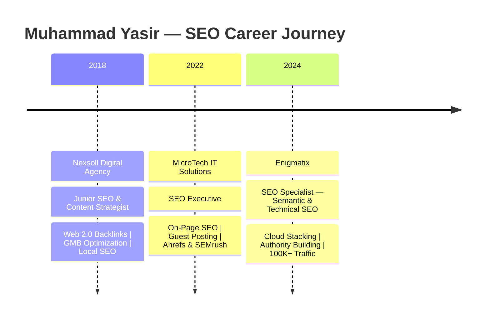

<div align="center">

<!-- Animated Header Banner -->


🚀 **Scaling Websites from 0 → 100K+ Monthly Visitors**
🔗 **Cloud Stacking & Authority Link Builder**
🧠 **Semantic SEO & Topic Cluster Architect**
⚡ **Technical SEO Audits & Core Web Vitals**
📈 **Google Top 3 Rankings Specialist**

<br/>

<!-- Profile Views & Social Badges -->
<a href="mailto:Rankwithyaasir@gmail.com">
  
</a>
<a href="https://wa.me/923099221249?text=Hi%20Yasir%2C%20I%20need%20help%20with%20SEO%20for%20my%20website.%20Can%20you%20help%20me%3F" target="_blank">
  
</a>


</div>

---

<!-- About Me Section -->


## 🧑‍💻 About Me

```yaml
Name        : Muhammad Yasir
Title       : SEO Specialist | Link Building Expert
Location    : Pakistan 🇵🇰
Experience  : 4+ Years in SEO
Current     : Enigmatix (2024 – Present)
Specialty   : Semantic SEO + Cloud Stacking
Achievement : 0 → 100K+ Monthly Organic Visitors
Freelance   : Available ✅
Email       : Rankwithyaasir@gmail.com
```

> *"I don't just build backlinks — I build **authority systems** that make Google trust you."*

---

## 🏆 Key Achievements

<div align="center">

|  🚀 Achievement | 📊 Result |
|---|---|
| Organic Traffic Growth | **0 → 100K+ Monthly Visitors** |
| Google Rankings | **Top 3 Positions** for Competitive Keywords |
| Cloud Stacking Systems | **Scaled as Premium Freelance Service** |
| Markets Served | 🇵🇰 Pakistan · 🇦🇪 UAE · 🇺🇸 USA |
| Link Networks Built | **DR40+ Guest Posts & Authority Stacks** |

</div>

---

## ⚡ SEO Expertise

<div align="center">

### 🔧 Technical SEO


### 🔗 Link Building & Off-Page SEO


-FF9900?style=for-the-badge&logo=amazon&logoColor=white)


### 🧠 Semantic SEO


### 📊 Tools & Analytics


</div>

---

## 🛠️ Services I Offer

<div align="center">

```
╔══════════════════════════════════════════════════════════════════════════╗
║                       🔥 PREMIUM SEO SERVICES                           ║
╠══════════════════════════════════════════════════════════════════════════╣
║  ☁️  Cloud Stacking Backlinks  →  Cloudflare · GitHub · GitLab           ║
║                                   Netlify · Codeberg Asset Networks      ║
╠══════════════════════════════════════════════════════════════════════════╣
║  🔵 Google Entity Backlinks   →  Sites · Docs · Sheets · Drive           ║
║                                   Powerful Internal Link Chains          ║
╠══════════════════════════════════════════════════════════════════════════╣
║  🌐 Web 2.0 Backlinks         →  High Authority Contextual Links         ║
╠══════════════════════════════════════════════════════════════════════════╣
║  ⚡  Nandla Backlinks          →  Premium Nandla Network Links           ║
╠══════════════════════════════════════════════════════════════════════════╣
║  📦 Softranks                 →  Amazon Publisher · Chrome Extension     ║
║                                   Firefox Addons Backlinks               ║
╠══════════════════════════════════════════════════════════════════════════╣
║  💬 Forum Backlinks           →  Niche Relevant Forum Authority          ║
╠══════════════════════════════════════════════════════════════════════════╣
║  ✍️  Blog Commenting           →  Contextual Blog Comment Links          ║
╠══════════════════════════════════════════════════════════════════════════╣
║  🎙️  Podcast Submission        →  Podcast Directory Backlinks            ║
╠══════════════════════════════════════════════════════════════════════════╣
║  🎬 Video & PDF Submission    →  Multimedia Backlink Signals             ║
╠══════════════════════════════════════════════════════════════════════════╣
║  📰 Guest Posts               →  DR40+ Website Outreach                 ║
╚══════════════════════════════════════════════════════════════════════════╝
```

</div>

---

## 💼 Work Timeline



---

## 🌐 Cloud Stacking Network

<div align="center">

```
                    ┌─────────────────┐
                    │   YOUR WEBSITE  │ ← Main Target
                    └────────┬────────┘
                             │ Link Equity Flow
          ┌──────────────────┼──────────────────┐
          │                  │                  │
   ┌──────▼──────┐   ┌───────▼──────┐  ┌───────▼──────┐
   │  Cloudflare │   │    GitHub    │  │    GitLab    │
   │    Pages    │   │    Pages     │  │    Pages     │
   └──────┬──────┘   └───────┬──────┘  └───────┬──────┘
          │                  │                  │
          └──────────────────▼──────────────────┘
                    ┌─────────────────┐
                    │ Google Authority│
                    │    Stacking     │
                    │  Sites · Docs   │
                    │  Sheets · Drive │
                    └─────────────────┘
```

*Custom cloud stacking systems that pass maximum link equity & trust signals.*

</div>

---

## 📈 SEO Stats Snapshot

<div align="center">

</div>

---

## 🤝 Let's Collaborate

<div align="center">

**Open for Remote SEO Roles & Freelance Projects**

<a href="mailto:Rankwithyaasir@gmail.com">
  
</a>
&nbsp;
<a href="https://www.linkedin.com/in/yasir-shafique-14a256398">
  
</a>
&nbsp;
<a href="https://wa.me/923099221249?text=Hi%20Yasir%2C%20I%20need%20help%20with%20SEO%20for%20my%20website.%20Can%20you%20help%20me%3F" target="_blank">
  
</a>

<br/><br/>

*"Let's rank your website where it belongs — **Page 1, Position 1.**"* 🎯

</div>

<!-- Footer Wave -->

